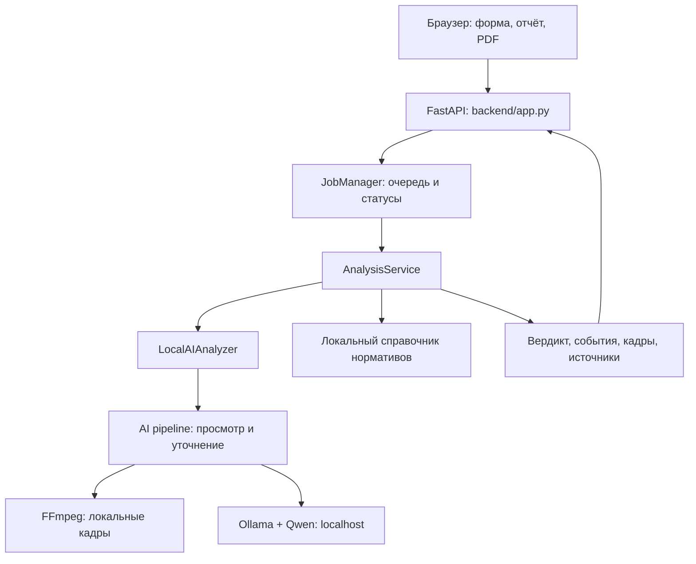

# ForteLens — локальный анализ кассовых видео

**ForteLens** — прототип для предварительной проверки видеозаписей кассовых операций. Он помогает сотруднику внутреннего контроля банка найти фрагменты, требующие внимания: показывает предполагаемое событие, временную отметку, кадры и связанное нормативное основание, если оно есть в справочнике.

Видеозапись обрабатывает локальная модель Qwen через Ollama. Пользователь работает в браузере; интерфейс и API обслуживаются одним сервером. Вывод системы предназначен для проверки специалистом.

## 1. Что реализовано

| Возможность | Реализация |
| --- | --- |
| Загрузка видео | Форма и multipart API для файлов `.mov` и `.mp4` |
| Фоновая обработка | Идентификатор задания, очередь и статусы `processing`, `done`, `failed` |
| Анализ кадров | Локальная Qwen3-VL; первичный просмотр и повторная проверка найденных кандидатов |
| Результат | `violation` либо `no_violation`; ошибки возвращаются отдельно |
| Доказательства | Описание, время события и 1–3 JPEG-кадра на событие |
| Нормативный справочник | Сопоставление по точному `rule_id`; акт, пункт, ссылка и статус проверки источника |
| Отчёт | Карточки событий и общий PDF с кадрами и русским текстом |
| Доступ к API | `X-API-Key` для программных клиентов; браузерная сессия для сайта |
| Локальная сеть | Один компьютер выполняет анализ, другие устройства подключаются через браузер |
| Подготовка окружения | Запускатель проверяет ресурсы, подготавливает зависимости и локальную модель |
| Демо | Отдельный режим `?demo=1` для просмотра интерфейса |

Событие без подтверждённого нормативного соответствия получает пометку **«Нужна проверка регламента»**. Наличие события и подтверждение применимости закона — отдельные проверки.

### Настроенные категории событий

В `ai_service/config/rules.json` включены следующие категории с отмеченным в локальном справочнике источником:

| Код | Что проверяет правило |
| --- | --- |
| `unattended_cash` | Уход кассира до завершения обслуживания клиента |
| `cash_not_secured_between_clients` | Ранее принятые деньги остаются вне устройства хранения при следующей операции |
| `count_after_client_exit` | Первичный пересчёт принимаемых денег после ухода клиента |
| `cash_issued_without_count` | Отсутствие пересчёта подготовленной к выдаче суммы в присутствии клиента |
| `uncounted_unsealed_cash` | Приём банкнот непосредственно от клиента без полистного пересчёта |
| `personal_items_on_desk` | Хранение установленных личных вещей работника в кассовом узле |

Это перечень настроенных проверок, а не заявленная точность их распознавания. Для каждой категории конфигурация содержит условия применимости и контрпримеры. Спорные категории, например общий запрет оставлять ключ в замке или пить за столом, отключены в каталоге AI-правил до подтверждения применимого основания.

## 2. Как работает решение

1. Пользователь открывает сайт и выбирает MOV- или MP4-файл.
2. Браузер отправляет файл серверу и получает `job_id`.
3. Задание поступает в очередь. Один worker выполняет анализ, ещё одно задание может ожидать.
4. FFmpeg читает видео и извлекает кадры. Pipeline группирует их в окна и отправляет локальной Qwen через Ollama.
5. Найденные кандидаты проходят уточняющую проверку на дополнительных кадрах. Система формирует описание и кадры-доказательства.
6. `AnalysisService` сопоставляет `rule_id` с локальным нормативным справочником. Свободный текст модели не используется как источник закона.
7. Браузер получает результат. При наличии событий пользователь открывает отчёт, сверяет кадры с записью и скачивает PDF.

Отрицательный результат относится к настроенным категориям и не подтверждает отсутствие всех возможных нарушений. Некорректный ответ модели, нехватка памяти и истечение времени возвращаются как ошибка.

## 3. Технологии

| Компонент | Технологии |
| --- | --- |
| Язык серверной части | Python 3.10+, 64 бита; в инструкциях проекта рекомендуется Python 3.12 |
| HTTP-сервис | FastAPI `0.143.3`, Uvicorn `0.54.0` |
| Фронтенд | HTML, CSS, JavaScript; готовые файлы в `frontend/dist/`, без обязательной npm-сборки |
| AI | Qwen3-VL-2B-Instruct, тег Ollama `qwen3-vl:2b-instruct-q4_K_M` |
| Локальный запуск модели | Ollama, внутренний HTTP-интерфейс на loopback |
| Видео и изображения | FFmpeg, `imageio-ffmpeg >=0.6,<0.7`, Pillow `>=10.4,<13` |
| PDF | `pdf-lib 1.17.1`, `@pdf-lib/fontkit 1.1.1`, шрифт Noto Sans |
| Нормативные данные | Python dictionaries `ACTS` и `REGULATIONS` |
| Проверки | Python `unittest`; тесты HTTP используют управляемый анализатор |

Зависимости сервиса описаны в [backend/requirements.txt](https://github.com/8zellorr8/datathon_ketnavr/blob/main/backend/requirements.txt) и [ai_service/requirements.txt](https://github.com/8zellorr8/datathon_ketnavr/blob/main/ai_service/requirements.txt). Библиотеки PDF и шрифты хранятся в репозитории: [лицензии](https://github.com/8zellorr8/datathon_ketnavr/blob/main/frontend/dist/vendor/THIRD-PARTY.txt).

Эта сборка использует готовые квантованные веса Qwen. Подключение интерфейса и подготовка весов запускателем не являются дообучением модели. Внешние API OpenAI, NVIDIA или других облачных AI-сервисов в рабочем pipeline не используются.

## 4. Архитектура



Основные каталоги:

```text
frontend/
  dist/                     Интерфейс, клиент API, PDF, библиотеки и шрифты
  INTEGRATION.md            Контракт между интерфейсом и сервером
backend/
  app.py                    HTTP-маршруты и раздача фронтенда
  auth.py                   API-ключ и браузерные сессии
  service.py                Проверка результата и сопоставление с нормативами
  analyzer.py               Адаптер локального AI
  catalogue.py              Справочник актов и типов событий
  repository.py             Доступ к справочнику
  tests/                    Проверки слоя приложения
ai_service/
  Start-ForteBank.py         Подготовка и единый запуск
  Start-LAN.cmd              Запуск для локальной сети в Windows
  portable_hardware.py      Диагностика оборудования и выбор профиля
  forte_ai/pipeline.py       Анализ видео и уточнение событий
  forte_ai/local_vlm.py      Обращение к локальной Ollama
  forte_ai/video.py          Работа с FFmpeg
  forte_ai/server.py         Очередь, multipart и проверка результата
  config/                   Настройки модели и правил
  tests/                    Проверки AI-pipeline и транспорта
```

FastAPI вызывает AI внутри того же приложения через адаптер. Отдельный публичный сервис модели не требуется. Браузер обращается к серверу сайта; Ollama остаётся на `127.0.0.1`.

## 5. Установка и запуск

### Требования

- 64-битный Python 3.10+ (рекомендуется 3.12) и Ollama для своей ОС.
- Git для клонирования репозитория; при использовании ZIP он не нужен.
- Python и Ollama доступны из командной строки.
- Интернет при первоначальной установке пакетов и загрузке весов.
- Свободное место для окружения, модели и временных файлов.
- Достаточная RAM и, при использовании GPU, видеопамять. Диагностика выбирает профиль, но не гарантирует завершение анализа на любом оборудовании.

### Шаг 1. Получить проект

```bash
git clone --branch main https://github.com/8zellorr8/datathon_ketnavr.git
cd datathon_ketnavr
```

Если проект уже скачан, перейдите в его корневую папку с каталогами `backend`, `frontend` и `ai_service`.

### Шаг 2. Запустить сервис

Все команды ниже выполняются **из корня репозитория**, где находятся `backend`, `frontend` и `ai_service`. Устанавливать модель нужно только на компьютере, который будет выполнять анализ.

#### Windows — PowerShell

```powershell
.\ai_service\Start-ForteBank.cmd
```

Альтернативный запуск через Python:

```powershell
python ai_service/Start-ForteBank.py
```

В PowerShell для файлов из текущей папки нужен префикс `.\`. Для перехода в папку используйте `cd "путь"`; ключ `/d` относится к CMD.

#### Linux — терминал

```bash
python3 --version
python3 ai_service/Start-ForteBank.py
```

Если не удаётся создать виртуальное окружение, установите пакет `python3-venv` через пакетный менеджер дистрибутива. Ollama должна быть установлена и доступна из терминала.

#### macOS — терминал

```bash
python3 --version
python3 ai_service/Start-ForteBank.py
```

Ollama выбирает доступное ускорение автоматически. На macOS не добавляйте `--cpu`: запускатель не поддерживает этот флаг для данной ОС.

На Linux и macOS также доступна оболочка:

```bash
sh ai_service/Start-ForteBank.sh
```

Запускатель подготавливает Python-окружение, проверяет зависимости и FFmpeg, находит или запускает Ollama, проверяет модель и запускает FastAPI. При отсутствии весов первая подготовка загружает их. **Это установка готовой модели, а не дообучение.** Оставьте окно консоли открытым; `Ctrl+C` завершает сервисы, запущенные этим окном.

После запуска откройте **http://127.0.0.1:8001**. API-ключ вводить в браузере не требуется.

Для Linux и macOS предусмотрены запускатели, но наличие этих файлов не подтверждает успешный запуск на всех устройствах. Фактическое ускорение, память и время анализа нужно проверить на целевом компьютере.

### Шаг 3. Работа без скачивания пакетов и весов

После первоначальной подготовки на Windows:

```powershell
.\ai_service\Start-ForteBank.cmd --offline
```

На Linux и macOS:

```bash
python3 ai_service/Start-ForteBank.py --offline
```

При отсутствии необходимых пакетов или весов этот режим завершится ошибкой. Обработка использует локальную модель. Практические результаты и ограничения автономности описаны в [VALIDATION.md](https://github.com/8zellorr8/datathon_ketnavr/blob/main/ai_service/VALIDATION.md).

### Доступ с других устройств через Wi-Fi

На компьютере с моделью в Windows:

```powershell
.\ai_service\Start-LAN.cmd
```

На Linux и macOS:

```bash
python3 ai_service/Start-ForteBank.py --lan
```

Можно добавить `--offline`, если окружение и веса уже подготовлены.

Остальные устройства должны находиться в той же локальной сети. Откройте адрес Wi-Fi IPv4 компьютера с моделью и портом `8001`, напечатанный запускателем, например `http://192.168.1.15:8001`. Если адресов несколько, выбирайте адрес действующего Wi-Fi-подключения.

**Клиентским устройствам нужны только браузер и доступ к серверу.** Это может быть другой Windows/Linux/macOS-компьютер, Android или iPhone. Python, Ollama и GPU на клиентах не нужны. Адрес `127.0.0.1` на телефоне указывает на сам телефон и для подключения к ноутбуку не подходит.

Если входящие подключения блокирует Windows Firewall, предусмотрен `ai_service/Enable-WiFi.cmd`: его запускают от имени администратора. Правило относится к локальной подсети и порту `8001`. При другом порте требуется соответствующая настройка firewall.

На Linux и macOS разрешите входящие подключения к выбранному порту средствами системы. Изоляция клиентов в гостевой Wi-Fi-сети может мешать соединению. Ноутбук с ИИ должен оставаться включённым, а сервер — запущенным. `--lan` открывает доступ внутри сети; публичный HTTPS-адрес настраивается отдельно.

### Полезные параметры

```powershell
# Диагностика без установки и запуска сервисов
python ai_service/Start-ForteBank.py --check

# Другой порт сайта
python ai_service/Start-ForteBank.py --port 8003

# Подготовленный сервис без автоматического открытия браузера
python ai_service/Start-ForteBank.py --offline --no-browser
```

Порты по умолчанию: сайт/API — `8001`, Ollama — `11435`. Готовность `/health` подтверждает работу HTTP-сервера, но не факт выполнения моделью анализа. Для ручного запуска FastAPI и параметров модели см. [backend/README.md](https://github.com/8zellorr8/datathon_ketnavr/blob/main/backend/README.md) и [переносимый запуск](https://github.com/8zellorr8/datathon_ketnavr/blob/main/ai_service/docs/PORTABLE_START.txt).

Для Linux/macOS в приведённых командах диагностики используйте `python3`. Принудительный запуск на CPU доступен в Windows/Linux через `--cpu`; если Ollama уже работает, нужен отдельный свободный `--model-port`. На CPU возможны существенное замедление и превышение дедлайна. Доступность сайта и наличие модели в `ollama list` сами по себе не подтверждают, что видео успешно проанализировано.

## 6. Как проверить решение жюри

### Через интерфейс

1. Запустите проект и откройте главную страницу.
2. Выберите предоставленный для проверки `.mov` или `.mp4` длительностью до 180 секунд. Размер файла должен быть меньше 64 МиБ; весь multipart-запрос также ограничен 64 МиБ.
3. Нажмите «Проверить видео». Дождитесь результата или явного сообщения об ошибке.
4. При найденных событиях проверьте описание, временные отметки и 1–3 кадра каждого события по исходной записи.
5. Проверьте статус нормативного основания. Для неподтверждённого соответствия должна быть пометка о проверке регламента.
6. При положительном результате откройте отчёт и скачайте общий PDF. Для `no_violation` список событий пуст; отчёт с событиями не открывается.
7. Выберите другой файл: предыдущий отчёт должен сброситься. Неподдерживаемое расширение должно дать ошибку, без фиктивного вердикта.

Для отдельного просмотра учебных примеров интерфейса откройте **http://127.0.0.1:8001/?demo=1**. Демо явно отделено от анализа загруженного файла и не используется как запасной ответ модели.

### Через API

Все маршруты `/api/v1/*` требуют заголовок `X-API-Key`. Запускатель создаёт ключ в `ai_service/data/runtime/api-key.txt`. При заданном `FORTE_API_KEY` используется значение переменной окружения. Браузер получает HttpOnly-cookie и работает через `/ui/api/v1/*`.

Пример для PowerShell после запуска сервиса:

```powershell
$BaseUrl = "http://127.0.0.1:8001"
$Video = "C:\Videos\example.mov" # замените на существующий MOV или MP4
$JuryKey = if ($env:FORTE_API_KEY) { $env:FORTE_API_KEY } else { (Get-Content -Raw -LiteralPath ".\ai_service\data\runtime\api-key.txt").Trim() }

curl.exe -sS "$BaseUrl/health"
$Submitted = curl.exe -sS -H "X-API-Key: $JuryKey" -F "file=@$Video" "$BaseUrl/api/v1/analyze" | ConvertFrom-Json
curl.exe -sS -H "X-API-Key: $JuryKey" "$BaseUrl/api/v1/jobs/$($Submitted.job_id)"
```

Пример для Linux/macOS, из корня репозитория:

```bash
BASE_URL="http://127.0.0.1:8001"
VIDEO="/absolute/path/to/example.mov" # замените на существующий MOV или MP4
JURY_KEY="${FORTE_API_KEY:-$(cat ai_service/data/runtime/api-key.txt)}"

curl -sS "$BASE_URL/health"
curl -sS -H "X-API-Key: $JURY_KEY" -F "file=@$VIDEO" "$BASE_URL/api/v1/analyze"

# Скопируйте job_id из предыдущего ответа:
JOB_ID="вставьте_job_id"
curl -sS -H "X-API-Key: $JURY_KEY" "$BASE_URL/api/v1/jobs/$JOB_ID"
```

Повторяйте запрос статуса, пока он равен `processing`. При успешной загрузке запрос анализа возвращает HTTP `202` с `job_id`. API-ключ относится к вашему серверу и не является ключом облачного AI-сервиса. Передавайте его жюри отдельно; не добавляйте его в README или Git.

| Метод и путь | Назначение |
| --- | --- |
| `GET /health` | Состояние HTTP-сервера, без проверки качества и загрузки модели |
| `POST /api/v1/analyze` | Multipart-поле `file`; создание задания |
| `GET /api/v1/jobs/{job_id}` | Статус и результат задания |
| `GET /api/v1/regulations` | Локальный справочник нормативных соответствий |
| `GET /api/v1/regulations/{rule_id}` | Запись по точному идентификатору |
| `GET /openapi.json` | Схема API |
| `GET /docs` | Swagger UI; его ресурсы загружаются с CDN |

Ответ задания имеет плоскую структуру:

- `processing`: `job_id`, `status`.
- `done`: `job_id`, `status`, `verdict`, `violations`, `analysis`.
- `failed`: `job_id`, `status`, `error`; успешный вердикт отсутствует.

Элемент `violations` содержит `type`, `timecode_sec`, `description`, `evidence_frames`, `rule_id`, `rule_source` и статус проверки. В `evidence_frames` передаются `timestamp_sec` и JPEG в `image_base64`. У неподтверждённого соответствия `rule_source` равен `null`.

Неверный ключ возвращает `401`, переполненная очередь — `429`, слишком большой запрос — `413`. Для загрузки необходим `Content-Length`; передача с `Transfer-Encoding` не поддерживается.

### Проверки кода

Для отдельного окружения проверок на Windows, из корня репозитория:

```powershell
python -m venv .venv
.\.venv\Scripts\python.exe -m pip install -r backend/requirements.txt
.\.venv\Scripts\python.exe -m backend check
.\.venv\Scripts\python.exe -m unittest discover -s backend/tests -v
```

Для Linux/macOS:

```bash
python3 -m venv .venv
.venv/bin/python -m pip install -r backend/requirements.txt
.venv/bin/python -m backend check
.venv/bin/python -m unittest discover -s backend/tests -v
```

`backend check` проверяет согласованность справочника и активных AI-правил без запуска модели. HTTP-тесты используют управляемый анализатор и поднимают локальный сервер на свободном порту. Они проверяют протокол, очередь, ошибки и нормативное сопоставление; качество распознавания реальных видео оценивается отдельно. Дополнительные проверки AI находятся в `ai_service/tests/`.

## 7. Данные и интеграции

### Видеозаписи

Вход — предоставленная пользователем локальная запись `.mov` или `.mp4`. Приватные видео, таблицы разметки, локальные веса и runtime-ключи исключены из Git. Датасет не требуется для анализа отдельного загружаемого файла. Исследовательские команды подготовки данных и измерений находятся в `ai_service/`.

### Модель

Используемый тег и ожидаемый digest зафиксированы в [ai_service/config/local.json](https://github.com/8zellorr8/datathon_ketnavr/blob/main/ai_service/config/local.json). Запускатель проверяет соответствие модели. `local_vlm.py` допускает только loopback-адреса и не отправляет кадры облачным AI-сервисам. При запуске собственной Ollama выставляется `OLLAMA_NO_CLOUD=1`.

### Нормативная база

[backend/catalogue.py](https://github.com/8zellorr8/datathon_ketnavr/blob/main/backend/catalogue.py) содержит 12 записей типов событий; у 6 установлен `source_verified=True`. Версия справочника — `2026-10-17.1`. Основной акт указан в локальном справочнике; описание источников и пределов сверки — в [backend/SOURCES.md](https://github.com/8zellorr8/datathon_ketnavr/blob/main/backend/SOURCES.md).

Сопоставление выполняется по точному `rule_id`. Модель не назначает произвольные статьи. Флаг проверки источника не подтверждает юридическую квалификацию конкретного видео. Изменения законодательства и внутренние регламенты банка требуют отдельной проверки и обновления каталога.

### Сетевые обращения

Интернет нужен для первоначального получения зависимостей и модели. Во время анализа pipeline обращается к локальной Ollama; запросы к Adilet или другим правовым API не выполняются. Фронтенд, PDF-библиотеки и шрифты раздаются локально. Открытие внешней нормативной ссылки и Swagger UI могут требовать интернета. Интеграции с банковскими АБС и постоянной базой данных в этой версии нет.

## 8. Ограничения текущей версии

- **Распознавание может ошибаться:** возможны пропуски, ложные события и неверная классификация. Подтверждённая точность для произвольных записей или видео жюри не заявляется. История экспериментов и ограничения — в [VALIDATION.md](https://github.com/8zellorr8/datathon_ketnavr/blob/main/ai_service/VALIDATION.md); результаты старых конфигураций не следует переносить на изменённые настройки без повторной оценки.
- Проверяются только настроенные категории. Кадры выбираются с временным шагом; короткие действия, перекрытые объекты и другой ракурс могут ухудшить результат. Таймкоды и доказательства следует сверять по исходной записи.
- Поддерживаются `.mov` и `.mp4` до 180 секунд. Возможность чтения кодека определяется FFmpeg; повреждённые или неподдерживаемые записи возвращают ошибку. Для длинных роликов предусмотрены отдельные настройки окон, но успешная обработка любого такого файла не гарантируется.
- Лимит всего multipart-запроса — 64 МиБ. Общий дедлайн задания — 300 секунд с учётом загрузки и очереди; внутренний бюджет анализа в конфигурации — 270 секунд. Это ограничения исполнения, а не обещание скорости.
- Одновременно выполняется один анализ и допускается одно ожидающее задание. Результаты хранятся в памяти до часа, не более 100 завершённых заданий; перезапуск их удаляет. Постоянная история и аккаунты не реализованы.
- Кнопка прекращения ожидания отменяет браузерный опрос; серверное задание может продолжаться. API отмены задания не предусмотрен.
- Аппаратный профиль выбирается по доступным данным о системе. На слабом CPU/GPU возможны нехватка памяти и превышение времени. Поддержка всех ОС и видеокарт не гарантируется.
- Нормативный справочник покрывает часть событий и обновляется вручную. Итог требует проверки специалистом; система не выдаёт окончательного юридического или дисциплинарного заключения.
- Браузерная авторизация поддерживает localhost и частные адреса локальной сети по HTTP, а также один явно настроенный публичный HTTPS origin. Сам туннель или HTTPS-прокси нужно предоставить отдельно.
- Текущая сборка не включает подключённый пользовательский LoRA-адаптер и не заявляет дообучение модели на банковском датасете.

## 9. Адреса для сдачи и публичный доступ

Адреса подготовлены для сдачи 18 октября 2026 года:

| Поле формы | Значение |
| --- | --- |
| Web interface URL | https://stayed-flex-expert-carey.trycloudflare.com/ |
| API base URL | https://stayed-flex-expert-carey.trycloudflare.com |
| API key for the jury | Передаётся жюри отдельно; см. `ai_service/data/runtime/api-key.txt` на сервере |

Полный маршрут загрузки: `POST https://stayed-flex-expert-carey.trycloudflare.com/api/v1/analyze`.
Маршрут опроса: `GET https://stayed-flex-expert-carey.trycloudflare.com/api/v1/jobs/{job_id}`.
Оба требуют заголовок `X-API-Key`.

Сайт и API обслуживаются одним сервером, поэтому их базовый адрес совпадает.
Публичный адрес ведёт через временный HTTPS-туннель на локальный сервер порта `8001`.
Модель и анализ работают на ноутбуке. Туннель передаёт HTTP-запросы и ответы;
обращения к внешним облачным AI-сервисам не выполняются.

**Ссылка временная:** ноутбук, интернет, HTTP-сервис и туннель должны оставаться
включёнными всё время проверки. При новом запуске временного туннеля домен может
измениться; обновите поля формы и `FORTE_PUBLIC_ORIGIN`.

### Разрешить загрузку через публичный сайт

Сначала остановите ранее запущенный сервер через `Ctrl+C` в его окне.
Из корня проекта в Windows PowerShell выполните:

```powershell
$env:FORTE_PUBLIC_ORIGIN = "https://stayed-flex-expert-carey.trycloudflare.com"
.\ai_service\Start-ForteBank.cmd --offline --port 8001
```

На Linux/macOS:

```bash
export FORTE_PUBLIC_ORIGIN="https://stayed-flex-expert-carey.trycloudflare.com"
python3 ai_service/Start-ForteBank.py --offline --port 8001
```

Переменная содержит точный origin без завершающего слеша. После её изменения
нужен перезапуск HTTP-сервера. Затем заново откройте публичный сайт для получения
браузерной сессии. Без этого шага уже открывшаяся страница ещё не подтверждает
доступность загрузки через публичный домен. API для жюри использует ключ независимо
от браузерной сессии.

Эти команды не создают и не перезапускают туннель. Действующий туннель должен
по-прежнему направлять запросы на `http://127.0.0.1:8001`.
При настройке нового туннеля замените указанный домен на полученный адрес.
Ollama остаётся на loopback и отдельно в интернет не публикуется.

До сдачи проверьте внешний адрес, запрос с ключом и анализ видео. Работа `/health`
подтверждает доступность HTTP-сервера; она не подтверждает качество распознавания
или успешное завершение анализа.

Репозиторий проекта: [8zellorr8/datathon_ketnavr](https://github.com/8zellorr8/datathon_ketnavr).

## 10. Дополнительная документация

- [Бэкенд: API, запуск и устройство классов](https://github.com/8zellorr8/datathon_ketnavr/blob/main/backend/README.md)
- [Фронтенд: интерфейс и демо](https://github.com/8zellorr8/datathon_ketnavr/blob/main/frontend/README.md)
- [Контракт интеграции фронтенда](https://github.com/8zellorr8/datathon_ketnavr/blob/main/frontend/INTEGRATION.md)
- [AI: конфигурация и команды](https://github.com/8zellorr8/datathon_ketnavr/blob/main/ai_service/README.md)
- [История измерений и ограничения](https://github.com/8zellorr8/datathon_ketnavr/blob/main/ai_service/VALIDATION.md)
- [Нормативные источники](https://github.com/8zellorr8/datathon_ketnavr/blob/main/backend/SOURCES.md)
- [Переносимый запуск](https://github.com/8zellorr8/datathon_ketnavr/blob/main/ai_service/docs/PORTABLE_START.txt)
- [Доступ через локальную сеть](https://github.com/8zellorr8/datathon_ketnavr/blob/main/ai_service/docs/LOCAL_WIFI.txt)
- [Длинные видео](https://github.com/8zellorr8/datathon_ketnavr/blob/main/ai_service/docs/LONG_VIDEO.txt)
- [Сторонние библиотеки и лицензии](https://github.com/8zellorr8/datathon_ketnavr/blob/main/frontend/dist/vendor/THIRD-PARTY.txt)
