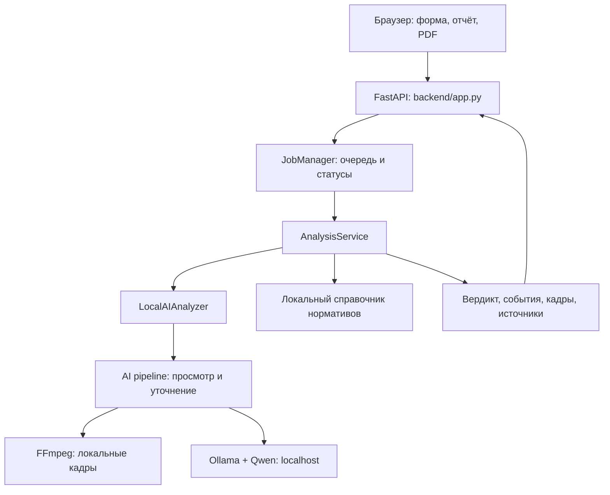

# ForteLens — локальный анализ кассовых видео

**ForteLens** — прототип для предварительной проверки видеозаписей кассовых операций. Он помогает сотруднику внутреннего контроля банка найти фрагменты, требующие внимания: показывает предполагаемое событие, временную отметку, кадры и связанное нормативное основание, если оно есть в справочнике.

Видеозапись обрабатывает локальная модель Qwen через Ollama. Пользователь работает в браузере; интерфейс и API обслуживаются одним сервером. Вывод системы предназначен для проверки специалистом.

## 1. Что реализовано

| Возможность | Реализация |
| --- | --- |
| Загрузка видео | Форма и multipart API для файлов `.mov` |
| Фоновая обработка | Идентификатор задания, очередь и статусы `processing`, `done`, `failed` |
| Анализ кадров | Локальная Qwen3-VL; первичный просмотр и повторная проверка найденных кандидатов |
| Результат | `violation` либо `no_violation`; ошибки возвращаются отдельно |
| Доказательства | Описание, время события и 1–3 JPEG-кадра на событие |
| Нормативный справочник | Сопоставление по точному `rule_id`; акт, пункт, ссылка и статус проверки источника |
| Отчёт | Карточки событий и общий PDF с кадрами и русским текстом |
| Доступ к API | `X-API-Key` для программных клиентов; браузерная сессия для сайта |
| Локальная сеть | Один компьютер выполняет анализ, другие устройства подключаются через браузер |
| Подготовка окружения | Запускатель проверяет ресурсы, подготавливает зависимости и локальную модель |
| Демо | Отдельный режим `?demo=1` для просмотра интерфейса |

Событие без подтверждённого нормативного соответствия получает пометку **«Нужна проверка регламента»**. Наличие события и подтверждение применимости закона — отдельные проверки.

## 2. Как работает решение

1. Пользователь открывает сайт и выбирает MOV-файл.
2. Браузер отправляет файл серверу и получает `job_id`.
3. Задание поступает в очередь. Один worker выполняет анализ, ещё одно задание может ожидать.
4. FFmpeg читает видео и извлекает кадры. Pipeline группирует их в окна и отправляет локальной Qwen через Ollama.
5. Найденные кандидаты проходят уточняющую проверку на дополнительных кадрах. Система формирует описание и кадры-доказательства.
6. `AnalysisService` сопоставляет `rule_id` с локальным нормативным справочником. Свободный текст модели не используется как источник закона.
7. Браузер получает результат. При наличии событий пользователь открывает отчёт, сверяет кадры с записью и скачивает PDF.

Отрицательный результат относится к настроенным категориям и не подтверждает отсутствие всех возможных нарушений. Некорректный ответ модели, нехватка памяти и истечение времени возвращаются как ошибка.

## 3. Технологии

| Компонент | Технологии |
| --- | --- |
| Язык серверной части | Python 3.10+, 64 бита; в инструкциях проекта рекомендуется Python 3.12 |
| HTTP-сервис | FastAPI `0.143.3`, Uvicorn `0.54.0` |
| Фронтенд | HTML, CSS, JavaScript; готовые файлы в `frontend/dist/`, без обязательной npm-сборки |
| AI | Qwen3-VL-2B-Instruct, тег Ollama `qwen3-vl:2b-instruct-q4_K_M` |
| Локальный запуск модели | Ollama, внутренний HTTP-интерфейс на loopback |
| Видео и изображения | FFmpeg, `imageio-ffmpeg >=0.6,<0.7`, Pillow `>=10.4,<13` |
| PDF | `pdf-lib 1.17.1`, `@pdf-lib/fontkit 1.1.1`, шрифт Noto Sans |
| Нормативные данные | Python dictionaries `ACTS` и `REGULATIONS` |
| Проверки | Python `unittest`; тесты HTTP используют управляемый анализатор |

Зависимости сервиса описаны в [backend/requirements.txt](backend/requirements.txt) и [ai_service/requirements.txt](ai_service/requirements.txt). Библиотеки PDF и шрифты хранятся в репозитории: [лицензии](frontend/dist/vendor/THIRD-PARTY.txt).

Эта сборка использует готовые квантованные веса Qwen. Подключение интерфейса и подготовка весов запускателем не являются дообучением модели. Внешние API OpenAI, NVIDIA или других облачных AI-сервисов в рабочем pipeline не используются.

## 4. Архитектура



Основные каталоги:

```text
frontend/
  dist/                     Интерфейс, клиент API, PDF, библиотеки и шрифты
  INTEGRATION.md            Контракт между интерфейсом и сервером
backend/
  app.py                    HTTP-маршруты и раздача фронтенда
  auth.py                   API-ключ и браузерные сессии
  service.py                Проверка результата и сопоставление с нормативами
  analyzer.py               Адаптер локального AI
  catalogue.py              Справочник актов и типов событий
  repository.py             Доступ к справочнику
  tests/                    Проверки слоя приложения
ai_service/
  Start-ForteBank.py         Подготовка и единый запуск
  Start-LAN.cmd              Запуск для локальной сети в Windows
  portable_hardware.py      Диагностика оборудования и выбор профиля
  forte_ai/pipeline.py       Анализ видео и уточнение событий
  forte_ai/local_vlm.py      Обращение к локальной Ollama
  forte_ai/video.py          Работа с FFmpeg
  forte_ai/server.py         Очередь, multipart и проверка результата
  config/                   Настройки модели и правил
  tests/                    Проверки AI-pipeline и транспорта
```

FastAPI вызывает AI внутри того же приложения через адаптер. Отдельный публичный сервис модели не требуется. Браузер обращается к серверу сайта; Ollama остаётся на `127.0.0.1`.

## 5. Установка и запуск

### Требования

- Установленные Git, 64-битный Python 3.10+ и Ollama.
- Python и Ollama доступны из командной строки.
- Интернет при первоначальной установке пакетов и загрузке весов.
- Свободное место для окружения, модели и временных файлов.
- Достаточная RAM и, при использовании GPU, видеопамять. Диагностика выбирает профиль, но не гарантирует завершение анализа на любом оборудовании.

### Шаг 1. Получить проект

```powershell
git clone --branch main https://github.com/8zellorr8/datathon_ketnavr.git
cd datathon_ketnavr
```

Если проект уже скачан, перейдите в его корневую папку с каталогами `backend`, `frontend` и `ai_service`.

### Шаг 2. Запустить сервис

Из корня репозитория:

```powershell
python ai_service/Start-ForteBank.py
```

Запускатель подготавливает Python-окружение, проверяет зависимости и FFmpeg, находит или запускает Ollama, проверяет модель и запускает FastAPI. При отсутствии весов первая подготовка загружает их. Оставьте окно консоли открытым.

На Windows можно открыть `ai_service/Start-ForteBank.cmd`. На Linux/macOS используйте `python3` вместо `python`, если так называется установленный интерпретатор.

После запуска откройте **http://127.0.0.1:8001**. API-ключ вводить в браузере не требуется.

### Шаг 3. Работа без скачивания пакетов и весов

После первоначальной подготовки:

```powershell
python ai_service/Start-ForteBank.py --offline
```

При отсутствии необходимых пакетов или весов этот режим завершится ошибкой. Обработка использует локальную модель. Практические результаты и ограничения автономности описаны в [VALIDATION.md](ai_service/VALIDATION.md).

### Доступ с других устройств через Wi-Fi

На компьютере с моделью:

```powershell
python ai_service/Start-ForteBank.py --lan
```

Альтернатива для PowerShell в Windows:

```powershell
.\ai_service\Start-LAN.cmd
```

Остальные устройства должны находиться в той же локальной сети. Откройте адрес IPv4 этого компьютера с портом `8001`, напечатанный запускателем. Клиентским устройствам нужны только браузер и доступ к серверу.

Если входящие подключения блокирует Windows Firewall, предусмотрен `ai_service/Enable-WiFi.cmd`: его запускают от имени администратора. Правило относится к локальной подсети и порту `8001`. При другом порте требуется соответствующая настройка firewall.

### Полезные параметры

```powershell
# Диагностика без установки и запуска сервисов
python ai_service/Start-ForteBank.py --check

# Другой порт сайта
python ai_service/Start-ForteBank.py --port 8003

# Подготовленный сервис без автоматического открытия браузера
python ai_service/Start-ForteBank.py --offline --no-browser
```

Порты по умолчанию: сайт/API — `8001`, Ollama — `11435`. Готовность `/health` подтверждает работу HTTP-сервера, но не факт выполнения моделью анализа. Для ручного запуска FastAPI и параметров модели см. [backend/README.md](backend/README.md) и [переносимый запуск](ai_service/docs/PORTABLE_START.txt).

## 6. Как проверить решение жюри

### Через интерфейс

1. Запустите проект и откройте главную страницу.
2. Выберите предоставленный для проверки `.mov` длительностью до 180 секунд. Размер файла должен быть меньше 64 МиБ; весь multipart-запрос также ограничен 64 МиБ.
3. Нажмите «Проверить видео». Дождитесь результата или явного сообщения об ошибке.
4. При найденных событиях проверьте описание, временные отметки и 1–3 кадра каждого события по исходной записи.
5. Проверьте статус нормативного основания. Для неподтверждённого соответствия должна быть пометка о проверке регламента.
6. При положительном результате откройте отчёт и скачайте общий PDF. Для `no_violation` список событий пуст; отчёт с событиями не открывается.
7. Выберите другой файл: предыдущий отчёт должен сброситься. Неподдерживаемое расширение должно дать ошибку, без фиктивного вердикта.

Для отдельного просмотра учебных примеров интерфейса откройте **http://127.0.0.1:8001/?demo=1**. Демо явно отделено от анализа загруженного файла и не используется как запасной ответ модели.

### Через API

Все маршруты `/api/v1/*` требуют заголовок `X-API-Key`. Запускатель создаёт ключ в `ai_service/data/runtime/api-key.txt`. При заданном `FORTE_API_KEY` используется значение переменной окружения. Браузер получает HttpOnly-cookie и работает через `/ui/api/v1/*`.

Пример для PowerShell после запуска сервиса:

```powershell
$BaseUrl = "http://127.0.0.1:8001"
$Video = "C:\Videos\example.mov" # замените на существующий MOV
$JuryKey = if ($env:FORTE_API_KEY) { $env:FORTE_API_KEY } else { (Get-Content -Raw -LiteralPath ".\ai_service\data\runtime\api-key.txt").Trim() }

curl.exe -sS "$BaseUrl/health"
$Submitted = curl.exe -sS -H "X-API-Key: $JuryKey" -F "file=@$Video" "$BaseUrl/api/v1/analyze" | ConvertFrom-Json
curl.exe -sS -H "X-API-Key: $JuryKey" "$BaseUrl/api/v1/jobs/$($Submitted.job_id)"
```

Повторяйте последний запрос, пока статус равен `processing`. При успешной загрузке первый запрос анализа возвращает HTTP `202` с `job_id`.

| Метод и путь | Назначение |
| --- | --- |
| `GET /health` | Состояние HTTP-сервера, без проверки качества и загрузки модели |
| `POST /api/v1/analyze` | Multipart-поле `file`; создание задания |
| `GET /api/v1/jobs/{job_id}` | Статус и результат задания |
| `GET /api/v1/regulations` | Локальный справочник нормативных соответствий |
| `GET /api/v1/regulations/{rule_id}` | Запись по точному идентификатору |
| `GET /openapi.json` | Схема API |
| `GET /docs` | Swagger UI; его ресурсы загружаются с CDN |

Ответ задания имеет плоскую структуру:

- `processing`: `job_id`, `status`.
- `done`: `job_id`, `status`, `verdict`, `violations`, `analysis`.
- `failed`: `job_id`, `status`, `error`; успешный вердикт отсутствует.

Элемент `violations` содержит `type`, `timecode_sec`, `description`, `evidence_frames`, `rule_id`, `rule_source` и статус проверки. В `evidence_frames` передаются `timestamp_sec` и JPEG в `image_base64`. У неподтверждённого соответствия `rule_source` равен `null`.

Неверный ключ возвращает `401`, переполненная очередь — `429`, слишком большой запрос — `413`. Для загрузки необходим `Content-Length`; передача с `Transfer-Encoding` не поддерживается.

### Проверки кода

Для отдельного окружения проверок на Windows, из корня репозитория:

```powershell
python -m venv .venv
.\.venv\Scripts\python.exe -m pip install -r backend/requirements.txt
.\.venv\Scripts\python.exe -m backend check
.\.venv\Scripts\python.exe -m unittest discover -s backend/tests -v
```

`backend check` проверяет согласованность справочника и активных AI-правил без запуска модели. HTTP-тесты используют управляемый анализатор и поднимают локальный сервер на свободном порту. Они проверяют протокол, очередь, ошибки и нормативное сопоставление; качество распознавания реальных видео оценивается отдельно. Дополнительные проверки AI находятся в `ai_service/tests/`.

## 7. Данные и интеграции

### Видеозаписи

Вход — предоставленная пользователем локальная запись `.mov`. Приватные видео, таблицы разметки, локальные веса и runtime-ключи исключены из Git. Датасет не требуется для анализа отдельного загружаемого файла. Исследовательские команды подготовки данных и измерений находятся в `ai_service/`.

### Модель

Используемый тег и ожидаемый digest зафиксированы в [ai_service/config/local.json](ai_service/config/local.json). Запускатель проверяет соответствие модели. `local_vlm.py` допускает только loopback-адреса и не отправляет кадры облачным AI-сервисам. При запуске собственной Ollama выставляется `OLLAMA_NO_CLOUD=1`.

### Нормативная база

[backend/catalogue.py](backend/catalogue.py) содержит 12 записей типов событий; у 6 установлен `source_verified=True`. Версия справочника — `2026-10-17.1`. Основной акт указан в локальном справочнике; описание источников и пределов сверки — в [backend/SOURCES.md](backend/SOURCES.md).

Сопоставление выполняется по точному `rule_id`. Модель не назначает произвольные статьи. Флаг проверки источника не подтверждает юридическую квалификацию конкретного видео. Изменения законодательства и внутренние регламенты банка требуют отдельной проверки и обновления каталога.

### Сетевые обращения

Интернет нужен для первоначального получения зависимостей и модели. Во время анализа pipeline обращается к локальной Ollama; запросы к Adilet или другим правовым API не выполняются. Фронтенд, PDF-библиотеки и шрифты раздаются локально. Открытие внешней нормативной ссылки и Swagger UI могут требовать интернета. Интеграции с банковскими АБС и постоянной базой данных в этой версии нет.

## 8. Ограничения текущей версии

- **Распознавание может ошибаться:** возможны пропуски, ложные события и неверная классификация. Подтверждённая точность для произвольных записей или видео жюри не заявляется. История экспериментов и ограничения — в [VALIDATION.md](ai_service/VALIDATION.md); результаты старых конфигураций не следует переносить на изменённые настройки без повторной оценки.
- Проверяются только настроенные категории. Кадры выбираются с временным шагом; короткие действия, перекрытые объекты и другой ракурс могут ухудшить результат. Таймкоды и доказательства следует сверять по исходной записи.
- Поддерживается `.mov` до 180 секунд. Для длинных роликов предусмотрены отдельные настройки окон, но успешная обработка любого такого файла не гарантируется.
- Лимит всего multipart-запроса — 64 МиБ. Общий дедлайн задания — 300 секунд с учётом загрузки и очереди; внутренний бюджет анализа в конфигурации — 270 секунд. Это ограничения исполнения, а не обещание скорости.
- Одновременно выполняется один анализ и допускается одно ожидающее задание. Результаты хранятся в памяти до часа, не более 100 завершённых заданий; перезапуск их удаляет. Постоянная история и аккаунты не реализованы.
- Кнопка прекращения ожидания отменяет браузерный опрос; серверное задание может продолжаться. API отмены задания не предусмотрен.
- Аппаратный профиль выбирается по доступным данным о системе. На слабом CPU/GPU возможны нехватка памяти и превышение времени. Поддержка всех ОС и видеокарт не гарантируется.
- Нормативный справочник покрывает часть событий и обновляется вручную. Итог требует проверки специалистом; система не выдаёт окончательного юридического или дисциплинарного заключения.
- Браузерная авторизация настроена для localhost и частных адресов локальной сети по HTTP. Внешний домен, HTTPS-прокси и публикация требуют отдельной настройки.
- Текущая сборка не включает подключённый пользовательский LoRA-адаптер и не заявляет дообучение модели на банковском датасете.

## 9. Развёрнутая версия

**Подтверждённый URL работающей публичной версии в репозитории не указан.**

После локального запуска интерфейс и API доступны по **http://127.0.0.1:8001** либо по адресу компьютера в локальной сети при `--lan`. Публичный адрес для жюри нужно подготовить и проверить отдельно. Репозиторий проекта: [8zellorr8/datathon_ketnavr](https://github.com/8zellorr8/datathon_ketnavr).

## 10. Дополнительная документация

- [Бэкенд: API, запуск и устройство классов](backend/README.md)
- [Фронтенд: интерфейс и демо](frontend/README.md)
- [Контракт интеграции фронтенда](frontend/INTEGRATION.md)
- [AI: конфигурация и команды](ai_service/README.md)
- [История измерений и ограничения](ai_service/VALIDATION.md)
- [Нормативные источники](backend/SOURCES.md)
- [Переносимый запуск](ai_service/docs/PORTABLE_START.txt)
- [Доступ через локальную сеть](ai_service/docs/LOCAL_WIFI.txt)
- [Длинные видео](ai_service/docs/LONG_VIDEO.txt)
- [Сторонние библиотеки и лицензии](frontend/dist/vendor/THIRD-PARTY.txt)
